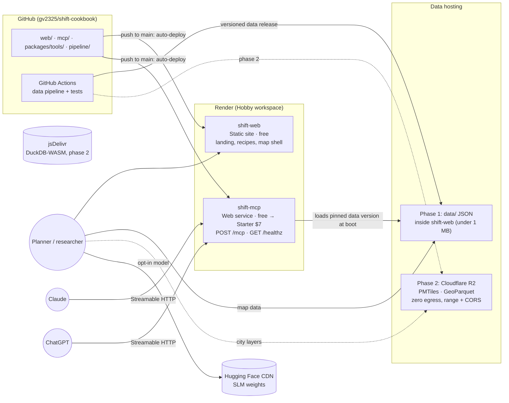
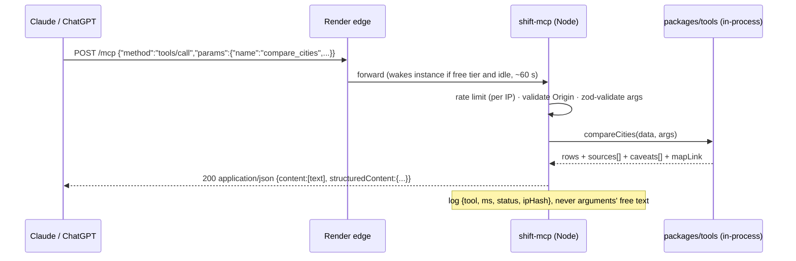

# System design: SHIFT Cookbook on Render, with an MCP endpoint

| | |
|---|---|
| **Status** | Proposal, for review |
| **Date** | 2026-11-08 |
| **Builds on** | [`docs/spec/PRD.md`](../spec/PRD.md). This document replaces the PRD's GitHub Pages hosting plan with Render. |
| **Budget** | $0 to start, about $7/month once the MCP endpoint must answer instantly |

---

## TL;DR

Run SHIFT as **two Render services from one repository**:

1. **`shift-web`**: a Render **static site** (Astro). It serves the landing page, the cookbook, and the map's app shell. It is free and never sleeps.
2. **`shift-mcp`**: a Render **web service** (Node/TypeScript). It serves a **stateless, read-only MCP endpoint** at `/mcp` for Claude and ChatGPT, plus a `/healthz` check. It starts on the free instance and moves to **Starter ($7/month)** once people rely on it, because free instances sleep after 15 minutes and take about a minute to wake.

The design follows from one constraint: **Render's free Hobby workspace now includes only 5 GB of outbound bandwidth a month**. Over that, Render bills $0.15 per GB, or pauses every service until next month if no card is on file. So Render serves only small things: HTML, CSS, JS, fonts, and MCP responses measured in kilobytes. Everything heavy is served from elsewhere:

- **Model weights** come from Hugging Face's CDN.
- **DuckDB-WASM** comes from jsDelivr.
- **Map tiles and large data files** come from **Cloudflare R2**, which charges nothing for egress, once city-level map layers exist (phase 2).

The MCP tools are written **once, in TypeScript, as pure functions over the published data**. The browser's local model and the MCP server run the same code, so an answer in Claude or ChatGPT always matches the map.

---

## 1. Requirements

### Functional

| # | Requirement | Served by |
|---|---|---|
| F1 | Landing page, cookbook recipes, methods and data pages | `shift-web` (static) |
| F2 | Map with a side-panel comparison of 20 Indian cities across transit, modes, traffic and safety | `shift-web` (MapLibre app shell) + data files |
| F3 | Optional local AI that drives the map from a model running in the browser | Browser (WebLLM) + weights from Hugging Face |
| F4 | Public MCP endpoint that needs no sign-in and works in Claude (custom connector) and ChatGPT (developer mode, deep research) | `shift-mcp` |
| F5 | Every number carries its source (dataset, publisher, year, licence) | Shared tool library + `catalog.json` |
| F6 | MCP results can link back to the map with the same view | `get_map_link` tool + the map's URL state |

### Non-functional

| Concern | Target |
|---|---|
| Cost | $0 to launch; ≤ $10/month at 10,000 visits and 50,000 MCP calls a month |
| Landing page | First visit ≤ 150 KB from Render (measured: about 90 KB gzipped) |
| MCP latency | p95 < 300 ms for a warm call. With the free instance, the first call after idle can take about 60 s (see §6). |
| Availability | Static site follows Render's CDN uptime. MCP: one instance with health checks and deploys that don't drop requests. |
| Privacy | No accounts, no cookies. MCP logs record the tool name, timing and a hashed IP, never prompt text. |
| Security | Read-only, no secrets at runtime, validated inputs, no free-form queries |

### Constraints

- A one- or two-person team, so as few moving parts as possible.
- Hosting on Render (decided). It can be mirrored to GitHub Pages without code changes.
- Data is public and small today: 20 cities × about 50 indicators, under 1 MB. It grows only when city-level map layers (bus stops, roads) are added.

---

## 2. High-level design



### Components

| Component | What it is | Why |
|---|---|---|
| `shift-web` | Astro static build (`web/dist`), Render static site | Free, served from Render's edge, never sleeps. Landing and recipes ship no JavaScript; only the map page loads MapLibre. |
| `shift-mcp` | Node 22 + `@modelcontextprotocol/sdk`, Streamable HTTP in stateless mode | Needs a server, so it can't run on a static host. Stateless mode means no sticky sessions and no session store, and it can add instances later. |
| `packages/tools` | TypeScript library: tool schemas (zod → JSON Schema) and pure functions such as `getIndicator` and `compareCities` | One implementation used by both the browser model and the MCP server. Replaces the PRD's plan for two implementations plus contract tests. |
| Data release | `data/v{YYYY.MM.N}/` with `catalog.json`, `cities.json`, `indicators.json` and `search-index.json` | Immutable and versioned. The site and the MCP server each pin a version, so a deploy never mixes data versions. |
| Cloudflare R2 (phase 2) | Object storage for PMTiles and GeoParquet | Render's 5 GB/month would be used up by map tiles, and Render's docs say nothing about HTTP range requests on static sites, which PMTiles needs. R2 has free egress, range requests and CORS. |
| Hugging Face, jsDelivr | Third-party CDNs for the model weights (0.5–1.2 GB) and DuckDB-WASM | Keeps the largest downloads off Render's bandwidth entirely. |

---

## 3. Data flows

### 3.1 A visitor reads the landing page

1. The browser fetches `index.html`, CSS and fonts from `shift-web`: about 90 KB on a first visit, about 7 KB when cached.
2. Story photos and maps load from ArcGIS, where WRI India hosts them.

### 3.2 A visitor compares cities on the map

1. `/map` loads the app shell (MapLibre plus the app code: about 300 KB gzipped, cached afterwards).
2. The app fetches `data/v2026.11.0/indicators.json` (about 20 KB gzipped) and renders the 20 city markers and the side panel.
3. Phase 2: zooming into a city requests `pmtiles` byte ranges from R2.
4. Every interaction calls the shared tool functions in the browser. State lives in the URL, so a copied link reproduces the view.

### 3.3 Claude or ChatGPT calls a tool



The server loads the pinned data release into memory once at startup and keeps a snapshot bundled in the image, so it still starts if the data host is down. It does no per-request I/O.

---

## 4. MCP endpoint in detail

### 4.1 Transport and protocol

| Decision | Choice | Reason |
|---|---|---|
| Transport | **Streamable HTTP**, single endpoint `/mcp` | The transport both Claude custom connectors and ChatGPT developer-mode connectors use. Remote servers must be on public HTTPS, and Render provides TLS. |
| Sessions | **Stateless**: `sessionIdGenerator: undefined`, with a fresh server and transport per request | No session store, works behind any load balancer, survives restarts. All tools are pure reads, so a session would add nothing. |
| Responses | JSON (`enableJsonResponse: true`), no server-sent event streams | Each call finishes in milliseconds, so streaming isn't needed. Plain JSON is also friendlier to proxies and cold starts. |
| Other methods | `GET /mcp` and `DELETE /mcp` → 405 | Nothing to stream or close when there are no sessions. |
| SDK | `@modelcontextprotocol/sdk` latest stable 1.x, pinned exactly | v2 is in beta. Revisit once v2 is stable. |
| Auth | **None** (public, read-only) | Required: the endpoint is meant to need no sign-in. Abuse is handled with rate limits (§4.4). |
| Origin header | If `Origin` is present, it must be on an allowlist: the SHIFT site, `https://claude.ai`, `https://chatgpt.com`. Requests with no `Origin` (server-to-server) are allowed. | The MCP spec asks servers to validate `Origin` to block DNS-rebinding attacks. Allowing absent Origins keeps the hosted assistants working. |

### 4.2 Tools

All tools are read-only and marked with `annotations: { readOnlyHint: true, openWorldHint: false }`.

| Tool | Input | Output (`structuredContent`) |
|---|---|---|
| `list_cities` | `region?: "india" \| "global"` | `[{id, name, population, indicators_available[]}]` |
| `list_indicators` | `theme?` | `[{id, title, unit, theme, definition, source_ids[]}]` |
| `get_indicator` | `city, indicator, year?` | `{city, indicator, value \| null, unit, year, sources[], caveats[]}` |
| `compare_cities` | `cities[] (≤10), indicator, per_capita?` | `{indicator, benchmark?, rows[{city, value \| null}], sources[], caveats[], map_link}` |
| `search` | `query` | `{results:[{id, title, url}]}` (the shape ChatGPT deep research expects) |
| `fetch` | `id` | `{id, title, text, url, metadata}` (recipe or dataset record) |
| `get_map_link` | `cities[], indicator, tab?` | `{url}`: a deep link into `/map?...` |

Rules every tool follows:

- **Missing is explicit.** If the source has `0` or nothing, the tool returns `value: null` with `caveats: ["not in SHIFT data"]` and never invents a value.
- **Known conflicts are reported.** If SHIFT's own tables disagree, the tool adds a caveat such as "Pune bus fleet is 1,988 in one SHIFT table and 2,002 in another".
- **Sources travel with the result.** The text content repeats the sources in a short line, so assistants that only read text still cite them.

### 4.3 Errors

| Case | Behaviour |
|---|---|
| Invalid arguments | JSON-RPC `-32602` with the zod message ("`cities` accepts at most 10 items") |
| Unknown city or indicator | A tool result with `isError: true` and the closest matches ("Did you mean Kochi?"), so the assistant can retry |
| Rate limited | HTTP 429 with `Retry-After` |
| Payload over 64 KB, or a request over 10 s | 413 / 503, logged |
| Data failed to load at startup | Serve the bundled snapshot. `/healthz` reports `"data":"snapshot"` so monitoring can alert. |

### 4.4 Abuse protection and limits

- **Rate limit:** a per-IP token bucket in memory, allowing 60 requests a minute with bursts of 20. IPs come from the forwarding header Render sets. One instance makes an in-memory limiter enough; switch to Render Key Value (Redis-compatible) if instances scale out.
- **Size caps:** request bodies up to 64 KB, at most 10 cities per call, query strings up to 200 characters.
- **No query language exposed:** tools use fixed parameters only; nothing like SQL is accepted from callers.
- **Minimal logs:** JSON lines with `{ts, tool, ms, status, ipHash}`. The IP hash is salted, and the salt rotates monthly. Argument text and prompt text are never logged.

---

## 5. Static site in detail

- **Build:** `npm ci && npm run build` in `web/`, published from `web/dist`. On Render the site serves from the root, so set `BASE_PATH=/` and `SITE_URL=https://<service>.onrender.com`, or a custom domain.
- **Cache headers** (set in the dashboard or the Blueprint):
  - `/_astro/*` → `public, max-age=31536000, immutable`, since these files have hashed names.
  - `/data/*` → `public, max-age=31536000, immutable`, since data folders are versioned.
  - `/*` → `public, max-age=0, must-revalidate`.
- **Map route:** `/map` is its own Astro page (an island hosting the MapLibre app), so no catch-all rewrite is needed.
- **Security headers:**
  - `Content-Security-Policy` allowing scripts from `self` and `cdn.jsdelivr.net`, images from `self`, `www.arcgis.com` and R2, and connections to `self`, `huggingface.co`, R2 and `shift-mcp`.
  - `Referrer-Policy: strict-origin-when-cross-origin`.
- **The existing GitHub Pages workflow** stays as a build check on pull requests, and can serve as a fallback mirror. Production deploys come from Render's Git integration.

### Draft Blueprint (`render.yaml`)

Field names to be checked against Render's Blueprint reference before merging:

```yaml
services:
  - type: web
    name: shift-web
    runtime: static
    rootDir: web
    buildCommand: npm ci && npm run build
    staticPublishPath: dist
    envVars:
      - key: BASE_PATH
        value: /
      - key: SITE_URL
        value: https://shift-web.onrender.com
    headers:
      - path: /_astro/*
        name: Cache-Control
        value: public, max-age=31536000, immutable
      - path: /data/*
        name: Cache-Control
        value: public, max-age=31536000, immutable

  - type: web
    name: shift-mcp
    runtime: node
    plan: free            # switch to starter ($7) when the endpoint is shared publicly
    rootDir: mcp
    buildCommand: npm ci && npm run build
    startCommand: node dist/server.js
    healthCheckPath: /healthz
    envVars:
      - key: DATA_VERSION
        value: v2026.11.0
      - key: DATA_BASE_URL
        value: https://shift-web.onrender.com/data
      - key: ALLOWED_ORIGINS
        value: https://shift-web.onrender.com,https://claude.ai,https://chatgpt.com
      - key: IP_HASH_SALT
        generateValue: true
```

---

## 6. Scale, cost and reliability

### Load estimate (year one)

| Driver | Assumption | Render bandwidth |
|---|---|---|
| Landing and recipe visits | 10,000/month at about 90 KB first visit, 30% returning | about 0.7 GB |
| Map sessions | 3,000/month at about 350 KB | about 1.0 GB |
| Data JSON | 3,000 × 20 KB | about 0.06 GB |
| MCP calls | 50,000/month at about 4 KB per response | about 0.2 GB |
| **Total from Render** | | **about 2 GB of the 5 GB included** |
| City map tiles (phase 2) | 3,000 sessions × 5–15 MB | 15–45 GB on **R2 at $0 egress** (would cost $1.50–6/month in overage on Render, and needs range requests) |
| SLM weights | 500 opt-ins × 1.1 GB | about 550 GB on **Hugging Face**, never Render |

MCP compute is small: 50,000 calls a month averages about 0.02 requests a second, and each call is an in-memory lookup well under 10 ms. One instance with 512 MB and 0.5 CPU is far more than enough.

### Monthly cost

| Item | Launch | Public endpoint |
|---|---|---|
| Render Hobby workspace | $0 | $0 |
| `shift-web` static site | $0 | $0 |
| `shift-mcp` | $0 (free instance) | **$7** (Starter) |
| Bandwidth overage | $0 | $0 (about 2 of 5 GB) |
| Cloudflare R2 (phase 2) | — | $0 (free tier: 10 GB stored, generous request quotas, no egress fees) |
| **Total** | **$0** | **$7** |

Add a payment method to the Render workspace even at $0. Without one, going over 5 GB **pauses every service until the next month**. With one, the overage is a few cents.

### Free instance vs Starter for `shift-mcp`

| | Free | Starter ($7) |
|---|---|---|
| Idle behaviour | Sleeps after 15 minutes with no traffic | Always on (to verify on Render's plan page) |
| First call after idle | About 60 s. Some MCP clients time out on connect and show the connector as broken. | Under 300 ms |
| Hours | Uses the workspace's 750 free hours a month | Not counted against free hours |
| Use it for | Building and private testing | Once the connector link is shared |

An outside uptime ping every 14 minutes could keep a free instance awake, since one always-on service fits in 750 hours. I don't recommend it: it works against Render's free-tier intent, and $7 removes the problem.

### Failure modes

| Failure | Effect | Mitigation |
|---|---|---|
| `shift-mcp` crashes or deploys | Calls fail for seconds | Render health checks plus zero-downtime deploys. Tools are idempotent, so assistants can safely retry. |
| Data host unreachable when MCP starts | Can't load the pinned release | Bundled snapshot; `/healthz` reports it |
| Bandwidth over 5 GB without a card | **Whole workspace paused** | Card on file; alert at 4 GB; heavy files on R2 and other CDNs |
| Hugging Face down | Local AI can't be enabled | The map works fully without AI; MCP is unaffected |
| R2 down (phase 2) | City layers missing | National view and side panel still work from JSON on Render |
| Render outage | Site and MCP down | The same build can deploy to GitHub Pages as a static mirror (workflow already in the repo). MCP has no fallback in v1. |

### Monitoring

- `/healthz` returns `{status, dataVersion, dataSource: "remote" | "snapshot", uptimeS}`.
- An external uptime check (free tier of Better Stack or UptimeRobot) on `/healthz` and the site, every 5 minutes, alerting by email.
- Watch Render's bandwidth graph, with a reminder at 80% of 5 GB.
- Weekly from the logs: calls per tool, error rate, p95 latency, distinct hashed IPs (the PRD's "distinct clients per week" metric).

---

## 7. Repository layout

```
shift-cookbook/
├── render.yaml                 # Blueprint: shift-web + shift-mcp
├── web/                        # Astro static site (exists: landing page)
│   └── public/data/v2026.11.0/ # Phase 1 data release, copied in by the pipeline
├── mcp/                        # Node MCP server (new)
│   ├── src/server.ts           # HTTP + Streamable HTTP transport, rate limit, origin check
│   ├── src/data.ts             # load pinned release, snapshot fallback
│   └── snapshot/               # bundled copy of the current release
├── packages/tools/             # shared TypeScript: schemas + pure tool functions + tests
└── pipeline/                   # Python: scrape/clean sources → versioned data release
```

Use npm workspaces so `web` and `mcp` both import `@shift/tools` from source. Each Render service builds only its own folder, so set Render's build filters to that folder plus `packages/tools/**`.

---

## 8. Trade-offs

| Decision | Chosen | Alternative | Why |
|---|---|---|---|
| Hosting split | Static site + separate web service | One web service serving the site and `/mcp` | One service would let the free tier's sleep take the website down too. Two services keep the site always-on for free and let each deploy on its own. |
| Heavy data | R2 (phase 2) | Render static site | 5 GB/month, and Render doesn't document range requests. R2 adds a second vendor, but only once map tiles exist. |
| MCP state | Stateless JSON | Sessions with event streams | Simpler, survives restarts, scales out. Costs nothing, because every tool is a pure read. |
| Tool implementation | One TypeScript library | Python server (DuckDB) + TypeScript browser | Avoids two implementations drifting apart. Data is under 1 MB, so no database is needed. Python stays in the offline pipeline. |
| Auth | None + rate limits | API keys or OAuth | The point is a connector anyone can add with one URL. Revisit if abuse appears. |
| MCP instance | Free → Starter | Free with keep-alive pings | $7 for reliable connections beats working against the free tier. |

---

## 9. What to revisit as it grows

- **Over about 5 GB a month from Render:** move the static site to a free CDN host (Cloudflare Pages or GitHub Pages), or move the workspace to Pro (25 GB included, $25/month flat per third-party reports, to verify). The MCP server stays on Render.
- **Over about 50 requests a second, or more than one instance:** move rate limits to Render Key Value, and keep the instances stateless.
- **Data beyond about 50 MB** (time series, global cities, GeoParquet): add DuckDB in Node inside `mcp/` with the Parquet files on R2, behind the same tool contracts.
- **Abuse:** add optional API keys for heavy users while keeping anonymous access rate-limited; add OAuth only if write tools ever appear.
- **MCP Apps / ChatGPT Apps UI:** return a map preview resource with `compare_cities`. The map's URL state already supports this.
- **SDK v2 and new spec revisions:** follow the stateless-request direction; this design already sits there.

---

## 10. Decisions needed

1. **Approve Starter ($7/month) for `shift-mcp`** before the connector link is shared publicly. Until then, free.
2. **Add a payment method** to the Render workspace, so going over 5 GB bills cents instead of pausing every service.
3. **Cloudflare R2 for phase 2** (city map layers): acceptable, or keep all data on Render and accept overage?
4. **Custom domain** (for example, `shift-cookbook.org`)? It changes `SITE_URL`, the CSP and the Origin allowlist.
5. **WRI India image permissions** (from the landing-page work), before the site is public.

## 11. Implementation order

1. `packages/tools`: schemas, pure functions and unit tests, using the 20-city dataset already scraped.
2. `mcp/`: stateless server, rate limit, Origin check, `/healthz`, snapshot. Test locally with the MCP Inspector.
3. `render.yaml`. Deploy both services on the free plan, then check:
   - Claude custom connector added by URL, with a 20-prompt smoke test
   - ChatGPT developer mode, plus deep research using `search`/`fetch`
   - cold-start behaviour on the free instance
4. Switch `shift-mcp` to Starter, publish the connect page, and add uptime monitoring.
5. Phase 2: R2 bucket, PMTiles from the pipeline, city zoom layers in the map.

---

### Sources

- Render: [outbound bandwidth](https://render.com/docs/outbound-bandwidth) (Hobby 5 GB, $0.15/GB, workspace paused with no payment method), [free instances](https://render.com/docs/free) (15-minute spin-down, about 1-minute wake, 750 hours), [static site headers](https://render.com/docs/static-site-headers), [changelog on free-tier spin-down](https://render.com/changelog/free-web-services-now-remain-active-while-receiving-websocket-messages)
- Third-party, to verify: [Render in mid-2026 (jwatte)](https://jwatte.com/blog/render-com-platform-review.md) for the 1 Aug 2026 bandwidth change from 100 GB, Starter at 512 MB / 0.5 CPU / $7, and Pro at $25 flat
- Range requests: [Render community thread on byte-range requests](https://community.render.com/t/mp4-videos-don-t-load-in-safari-for-a-deployed-static-site/1300), [Protomaps PMTiles docs](https://docs.protomaps.com/pmtiles/)
- MCP: [TypeScript SDK v2 docs (stateless example)](https://ts.sdk.modelcontextprotocol.io/v2/documents/examples_server_README.html), [stateless Streamable HTTP example](https://glama.ai/mcp/servers/@yigitkonur/example-mcp-server-streamable-http-stateless/blob/69e2a24dc36031669db3aff0b94ec73f4b4a694e/README.md), [AAIF: migrating to stateless requests](https://aaif.io/blog/migrate-sessions-to-stateless-requests-with-mcp-2026-07-28), [FastMCP ChatGPT integration](https://gofastmcp.com/integrations/chatgpt) (search/fetch for deep research)
