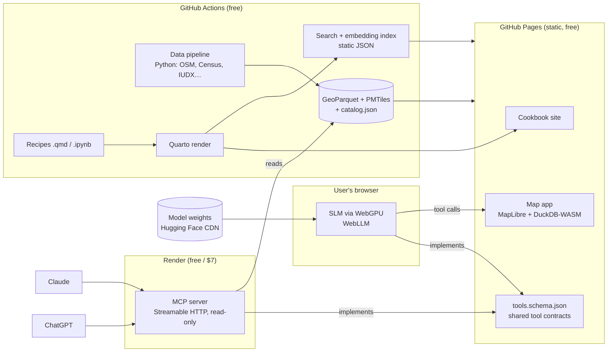

# PRD: SHIFT Cookbook, an SLM-native transport cookbook and map

| | |
|---|---|
| **Status** | Draft v0.1, for review |
| **Date** | 2026-11-08 |
| **Replaces** | [shift-transport.org](https://www.shift-transport.org/) ("SHIFT Transport: Transport Analytics Hub", Beta) |
| **Repo** | `gv2325/shift-cookbook` |
| **Hosting budget** | $0–7/month |

---

## TL;DR

Rebuild the SHIFT Transport Analytics Hub as an **open, static cookbook of transport "recipes"** in the style of the [PO.DAAC Cookbook](https://podaac.github.io/tutorials). The cookbook is paired with a **MapLibre map that a small language model (SLM) drives from inside the user's browser**. A **public MCP endpoint** exposes the same data and recipes to Claude and ChatGPT.

The site and data are hosted free on GitHub Pages. The model runs on the visitor's own GPU, so there is no inference bill. The only server is a small stateless MCP service on Render.

**The core design rule:** one set of tools, defined once, used by three clients: the in-browser SLM, the MCP endpoint, and the recipe notebooks. Every number a user sees comes from a tool result, never from model-generated text.

---

## 1. Problem Statement

Planners, researchers, journalists and advocates working on Indian urban mobility need answers to concrete questions. Examples: *"How does Pune's bus fleet compare with Bengaluru's per capita?"* or *"Where are the gaps in transit stop coverage in Indore?"* They also need to know where each number came from.

The current Transport Analytics Hub promises this for 20+ cities. In practice the main dashboard (`/analytics`) returns an HTTP 500, City Stories renders no content, there is no download, API or methodology, and the site states no license (findings from 2026-11-08). Users who arrive with a question leave without an answer. Users who do get a number cannot reuse it, reproduce it, or bring it into their own tools.

A dashboard is also the wrong shape for this audience. Fixed charts answer the questions their designers anticipated. Planners and researchers have their own questions and need the method as much as the result. That is what a cookbook provides and a dashboard does not.

---

## 2. Goals

| # | Goal | Type | Target |
|---|---|---|---|
| G1 | A first-time visitor gets a **cited, correct answer** to a city mobility question | User | Median **< 90 s** from landing to a cited answer in no-AI mode; **< 3 min** including the first SLM download |
| G2 | Every published number is **reproducible**: each answer and recipe links to its dataset, year, license and code | User / trust | **100%** of indicator values carry provenance; **0** unattributed numbers rendered |
| G3 | AI assistants can use SHIFT data directly | User / reach | The MCP endpoint works in **Claude and ChatGPT** at launch; **≥ 50 distinct clients/week** by month 3 |
| G4 | Runs at near-zero cost with no inference servers | Business | **≤ $7/month** total hosting at 10k monthly visitors |
| G5 | The community can extend it | Business | **≥ 5 externally contributed recipes** within 6 months of launch |

---

## 3. Non-Goals (v1)

| Non-goal | Why it is out of scope |
|---|---|
| **Server-side LLM inference** (hosted GPU, paid API keys) | Breaks G4. Frontier-model users connect through MCP instead. |
| **User accounts, saved workspaces, auth** | Static hosting has no backend for this. Shareable URLs encode map state instead. |
| **Real-time or live traffic feeds** | The audience needs planning data, not ops data. Live feeds also need a server and usually bring restrictive licenses. |
| **Global city coverage** | Parity with the 20 Indian cities first. The data model is city-agnostic, so adding cities is a data task, not a rebuild (see P2). |
| **Running the SLM on phones** | WebGPU on mobile is inconsistent and 1 GB downloads are hostile on mobile data. Phones get the full no-AI experience. |
| **Freeform, unbounded SQL from the model** | Small models write unreliable SQL. v1 uses parameterised query templates (see R-SLM-2). |

---

## 4. Personas and User Stories

**Personas**
- **City planner (Priya):** works at a municipal corporation or SPV. Comfortable with Excel, not with code. Needs defensible numbers for a DPR, CMP or board note.
- **Researcher (Arjun):** academic or think-tank analyst. Writes Python or R and wants raw data and reproducible methods.
- **Journalist or advocate (Meera):** needs a quick comparison and a chart or map to embed, with a citation.
- **AI-assistant user (Sam):** works in Claude or ChatGPT and wants SHIFT data inside that conversation.
- **Contributor (Kabir):** a domain expert who wants to publish a recipe.

**Stories (priority order)**

*Planner*
1. As a city planner, I want to ask a question in plain language and see the answer on a map with its source, so that I can use it in an official document without checking where it came from.
2. As a city planner, I want to compare two or more cities on the same indicator, normalised by population, so that I can benchmark my city fairly.
3. As a city planner, I want to export the map view and underlying table (PNG and CSV), so that I can paste them into a report.
4. As a city planner on a work laptop without a capable GPU, I want the site to work fully without the AI model, so that I am not blocked by my hardware.

*Researcher*
5. As a researcher, I want every recipe to include runnable code (Colab or Binder) against the same published data, so that I can reproduce and extend the analysis.
6. As a researcher, I want to download the cleaned datasets in open formats (GeoParquet, PMTiles, CSV) with a stated license, so that I can use them in my own pipeline.

*AI-assistant user*
7. As a Claude or ChatGPT user, I want to add SHIFT as a connector with one URL, so that I can ask about Indian city mobility and get cited data.
8. As a Claude or ChatGPT user, I want the assistant to return a link that opens the answer on the SHIFT map, so that I can see the result spatially.

*Journalist*
9. As a journalist, I want a shareable link that reproduces exactly the map and filters I am looking at, so that readers and editors can verify it.

*Contributor*
10. As a contributor, I want a recipe template and a PR checklist, so that I can publish a recipe without knowing the whole codebase.

*Edge cases*
11. As any user, when the model is unsure or the data does not exist (for example, a city or year not covered), I want an explicit "not in the data" response rather than a guess.
12. As any user on a slow connection, I want to be asked before a ~1 GB model downloads, with its size shown, so that I can decline.
13. As a returning user, I want the model to load from cache without re-downloading.
14. As an MCP user, when the server is cold-starting I want a clear, retryable error rather than a silent hang.

---

## 5. Solution Overview

**Three surfaces, one data and tool core:**

1. **Cookbook (the PO.DAAC part).** A Quarto site with recipes grouped under the existing four themes: *Public Transit Coverage, Active & Micro-Mobility, Road Traffic & Congestion, Modal Shift Trends*, plus *Getting Started* and *Data Guides*. Each recipe follows a fixed anatomy:
   - The question it answers
   - Datasets used (with year, publisher, license)
   - **No-code path:** an "Open in map" button that loads a preset map state and prompt
   - **Code path:** a notebook with an "Open in Colab" badge
   - Result
   - Caveats
   - "Ask in Claude/ChatGPT": a copyable prompt that uses the MCP tools
2. **Map (the LLM-driven part).** A MapLibre app at `/map`. Vector layers come from PMTiles; indicator queries run in DuckDB-WASM over Parquet. An optional chat panel drives the map with an in-browser SLM through tool calls. Without the SLM, the same tools are available as ordinary UI controls.
3. **MCP endpoint.** A stateless, read-only server implementing the same tools for Claude and ChatGPT. It returns cited data and deep links back into the map.

### Hosting and cost

| Component | Host | Cost | Constraint to design around |
|---|---|---|---|
| Cookbook, map app, data ≤ ~1 GB | GitHub Pages | $0 | 1 GB published-site limit, ~100 GB/month soft bandwidth, 100 MB per file. PMTiles need HTTP range requests (Pages supports them). |
| Data overflow (> 1 GB) | Cloudflare R2 or Source Cooperative | $0 (R2 free tier: 10 GB, no egress fees) | Only needed if national-scale layers are added |
| SLM weights | Hugging Face CDN (WebLLM default) | $0 | First load ~0.5–1.2 GB, cached in the browser afterwards |
| MCP server | Render web service | $0 free / $7 Starter | Free tier spins down after 15 min idle, with a ~30–60 s cold start (see OQ-4) |
| CI: data build, site build, evals | GitHub Actions | $0 (public repo) | Data pipeline must fit runner limits (6 h, ~14 GB disk) |
| Analytics | GoatCounter or Plausible CE | $0 | Privacy-respecting, no cookies |

---

## 6. Requirements

### P0: Must-have (cannot ship without)

**Data and provenance**

- **R-DATA-1: Reproducible data pipeline.** A Python pipeline in `pipeline/` builds every published dataset from its source, runs in GitHub Actions, and writes GeoParquet (tables and geometries), PMTiles (map layers) and `catalog.json` (dataset metadata).
  - [ ] One command rebuilds all datasets from scratch
  - [ ] Each dataset entry in `catalog.json` has: id, title, publisher, source URL, year or vintage, license, spatial and temporal coverage, processing script path
  - [ ] Pipeline fails the build if any dataset lacks a license field
- **R-DATA-2: City parity.** v1 covers the 20 cities currently listed (Ahmedabad, Bengaluru, Bhopal, Chennai, Coimbatore, Delhi, Hyderabad, Indore, Jaipur, Kanpur, Kochi, Kolkata, Kozhikode, Lucknow, Mumbai, Nagpur, Patna, Pune, Surat, Thrissur), each with a boundary and population.
  - [ ] Every city has a value or an explicit `null + reason` for each P0 indicator
- **R-DATA-3: Indicator set.** P0 indicators, each defined in `indicators.yaml` with formula, unit, source and caveats:
  - Bus fleet size per 100k population
  - Transit stop coverage (% of population within 500 m of a stop)
  - Route density (km per km²)
  - Road network density
  - Mode share (where available)
  - Road fatalities per 100k
  - [ ] Each indicator has a methodology page generated from its definition
- **R-DATA-4: License gate.** No dataset is published unless its license permits redistribution. Datasets that fail are excluded or published only as derived aggregates the license allows (see OQ-1 on Google Maps data).

**Cookbook**

- **R-CB-1: Static cookbook site.** Built with Quarto (the PO.DAAC Cookbook's stack) and deployed to GitHub Pages on every merge to `main`.
  - [ ] Navigation follows the four themes plus Getting Started, Data Guides, Contribute
  - [ ] Site builds in CI in < 15 min, and broken links fail the build
- **R-CB-2: Recipe anatomy.** Every recipe uses the template in `templates/recipe.qmd` with the required sections listed in §5. Front matter declares `datasets`, `cities`, `indicators`, `map_state` and `example_prompts`.
  - [ ] CI rejects a recipe missing any required section or front-matter field
  - [ ] Each code recipe executes in CI against published data (notebooks are tested, not just rendered)
- **R-CB-3: Launch content.** ≥ 12 recipes at launch: ≥ 3 per theme, plus "Getting Started: what data exists for my city" and "Comparing cities fairly (per-capita normalisation)".

**Map**

- **R-MAP-1: MapLibre map with no-AI mode.** `/map` loads city boundaries and P0 layers from PMTiles, with a city picker, layer toggles, an indicator choropleth or legend, a city comparison table, and a provenance panel for the visible data.
  - [ ] Fully usable with JavaScript enabled and no WebGPU
  - [ ] First meaningful paint < 3 s on a mid-range laptop over 10 Mbps
- **R-MAP-2: URL state.** The complete map state (city, layers, filters, viewport, active recipe) is encoded in the URL.
  - [ ] Opening a copied URL in a fresh browser reproduces the identical view
  - [ ] MCP `get_map_link` produces URLs in this format
- **R-MAP-3: Export.** PNG of the current view (with attribution and source footer) and CSV of the table behind it.

**Shared tool contracts**

- **R-TOOL-1: Single tool schema.** `tools/tools.schema.json` defines every tool as JSON Schema: name, description, params, result shape. The SLM runtime, the MCP server and the notebook helper library all implement it.
  - [ ] A contract test suite runs the same fixture calls against the browser and MCP implementations and asserts identical results
  - P0 tool set:

| Tool | Purpose |
|---|---|
| `list_cities` | Cities with population and data availability |
| `list_indicators` | Indicator definitions and units |
| `get_indicator(city, indicator, year?)` | A value with full provenance |
| `compare_cities(cities[], indicator, normalise?)` | A ranked table with provenance |
| `search` / `fetch` | Search over recipes and datasets; fetch a single doc. These names are required for ChatGPT deep research. |
| `get_map_link(state)` | A deep link to the map |
| `set_map_view`, `show_layer`, `filter_layer`, `highlight_features` | Browser-only map actions |

- **R-TOOL-2: Provenance in every result.** Every data-returning tool includes `sources: [{dataset_id, title, publisher, year, license, url}]`.

**In-browser SLM**

- **R-SLM-1: Opt-in local model.** The chat panel offers "Enable local AI" and shows the model name, download size, and that it runs on-device with no data leaving the browser. Runtime: WebLLM on WebGPU. Default model: Qwen3-1.7B (4-bit), with Qwen3-0.6B as a "lite" option (final choice set by the eval, R-SLM-4).
  - [ ] Nothing downloads before explicit consent
  - [ ] The model is cached; a second visit loads in < 15 s with no network fetch of weights
  - [ ] Without WebGPU, the panel explains why and points to no-AI mode and the MCP option
- **R-SLM-2: Constrained tool use.** The model can act only through the tools in R-TOOL-1, using schema-constrained (JSON) decoding. Data queries use parameterised templates, never model-written SQL.
  - [ ] Invalid tool calls are rejected and retried at most once, then the model asks the user to rephrase
- **R-SLM-3: Grounded answers.** Numbers in answers are rendered **by the UI from tool results** (as cards or tables with source chips), not as model-written digits. The model writes the connecting narrative only.
  - [ ] A post-processor flags any digit sequence in model text that does not match a tool-result value. Flagged text is suppressed and the tool card is shown instead.
  - [ ] When no tool returns data, the answer is "That's not in the SHIFT data" plus related recipes
- **R-SLM-4: Eval harness.** A versioned set of ≥ 200 questions with expected tool calls and arguments (`evals/`), run in CI against candidate models with a headless WebGPU browser.
  - [ ] Ship gate: ≥ 85% exact-match tool selection, ≥ 80% exact-match arguments, 0 ungrounded numbers in rendered output
  - [ ] Recipe retrieval uses a build-time static embedding index, loaded in the browser alongside the model

**MCP endpoint**

- **R-MCP-1: Remote MCP server.** Streamable HTTP transport at `https://<host>/mcp`. It is read-only and authless, implements the P0 tools except browser-only map actions, and reads the published Parquet and catalog (it has no data of its own).
  - [ ] Can be added as a custom connector in Claude and in ChatGPT (developer mode) using only the URL
  - [ ] ChatGPT deep research works (`search` and `fetch` present and conformant)
  - [ ] Tool descriptions tell the assistant to cite `sources` and offer `get_map_link`
- **R-MCP-2: Abuse and cost guardrails.** Per-IP rate limit (for example, 60 req/min), response size cap, request timeout, and no write tools.
- **R-MCP-3: Connect docs.** A "Use with Claude / ChatGPT" page with step-by-step setup for each, example prompts, and a cold-start note if on the free tier.

**Quality**

- **R-Q-1: Accessibility.** WCAG 2.1 AA for the cookbook and map controls. The map has a keyboard-navigable table equivalent.
- **R-Q-2: Attribution.** On-map attribution for OSM (ODbL) and every visible source, satisfied in exports as well.

### P1: Nice-to-have (fast follow)

- **R-P1-1: City Stories, recomposed as recipes.** Narrative long-form recipes per city (replaces the current empty `/citystories`).
- **R-P1-2: Recipe-to-map handoff in reverse.** A "Turn this map into a recipe" action that exports the current state, the tool-call log and auto-generated code as a recipe draft (the PR starter for contributors).
- **R-P1-3: WASM fallback model.** wllama (llama.cpp on WASM, CPU) with a ≤ 0.6B model for machines without WebGPU, clearly labelled as slower.
- **R-P1-4: Map-state resource in MCP.** Return a static map thumbnail URL alongside `get_map_link` so assistants can show an image.
- **R-P1-5: Embeddable widgets.** An `<iframe>` embed for a single indicator map or chart, for journalists.
- **R-P1-6: Recipe contribution kit.** Template repo, PR checklist and a CI bot that renders a preview deploy for recipe PRs.

### P2: Future (design for, do not build)

- **Global cities.** The schema is keyed by city id and country code, and the "Indian / Global" toggle already exists on the current site. Do not hard-code India-specific fields into the indicator schema.
- **Multilingual (Hindi and regional languages).** Keep UI strings in i18n files from day one. Qwen3 is multilingual, so evaluate in-language prompting later.
- **MCP Apps / ChatGPT Apps UI.** Render the interactive map inside the assistant. Keep map rendering separable from app chrome so it can be embedded.
- **Bring-your-own-key frontier model in the browser panel.** Keep the tool runtime model-agnostic (an OpenAI-compatible tool-call interface) so a hosted model can be swapped in.
- **Time series and scenario tools** (for example, "what if bus fleet +20%"). Keep `year` as a first-class dimension everywhere.

---

## 7. Success Metrics

**Leading (weeks 1–4 after launch)**

| Metric | Target (success / stretch) | Measurement |
|---|---|---|
| Visitors reaching a cited answer (tool card or recipe result viewed) | 40% / 60% of map sessions | GoatCounter custom events |
| SLM opt-in rate among WebGPU-capable visitors | 20% / 35% | Custom event on consent |
| SLM answer success (user does not rephrase within 30 s) | 70% / 80% | Local, opt-in, anonymous event |
| Model download abandonment | < 30% | Consent vs load-complete events |
| MCP successful tool calls per week | 200 / 1,000 | Render logs (no prompt content stored) |
| MCP error rate (5xx + timeouts) | < 2% | Render logs |

**Lagging (months 1–6)**

| Metric | Target | Measurement |
|---|---|---|
| Monthly hosting cost | ≤ $7 | Render and Cloudflare invoices |
| Distinct MCP clients per week (by month 3) | ≥ 50 | Hashed client-id or user-agent in logs |
| Externally contributed recipes | ≥ 5 by month 6 | Merged PRs from non-maintainers |
| Citations or reuse (reports, articles citing SHIFT data) | ≥ 10 by month 6 | Manual tracking plus referrer logs |
| Eval score on the held-out question set | No regression release over release | CI eval job |

Evaluate at 2 weeks, 6 weeks and 6 months.

---

## 8. Open Questions

**Blocking (answer before build)**

- **OQ-1 [Legal / Data]:** Can travel-time data derived from the **Google Maps API (2025)** be republished? Google Maps Platform terms generally prohibit caching and redistribution, so "Road Traffic & Congestion" may need an open replacement (for example, OSM-routed free-flow speeds, or Uber Movement-style open data where it exists). The terms for **IUDX** data also need checking.
- **OQ-2 [Stakeholder]:** Is this an **official successor** to shift-transport.org, built with WRI India and the partners (Rainmatter Foundation, Mint, Spectrum), or an **independent community fork** inspired by it (as this repo's README suggests)? This decides domain, branding and access to the "Master Data Sheet for TAH".
- **OQ-3 [Data]:** Can we get the processed **Master Data Sheet (2024)** and the CEPT mode-share figures behind the current hub, or must indicators be rebuilt from primary sources? The answer sets Phase 1 effort by weeks.

**Non-blocking**

- **OQ-4 [Engineering]:** MCP hosting. Options:
  - Render free: $0, but there is a ~30–60 s cold start after 15 min idle, which some MCP clients may time out on.
  - Render Starter: $7/month, no spin-down.
  - Cloudflare Workers free tier: no cold start, but needs a JS/WASM data layer instead of Python DuckDB.
  - *Recommendation:* Render free for beta, switch to Starter once weekly clients exceed ~20.
- **OQ-5 [Engineering]:** Final default SLM (Qwen3-1.7B or 0.6B, or an alternative) decided by the R-SLM-4 eval. Should we fine-tune a small model on our tool schema if base models miss the gate?
- **OQ-6 [Design]:** Should the chat panel be primary (chat-first) or secondary to the map controls (map-first)? Recommendation: map-first, since most users will be in no-AI mode.
- **OQ-7 [Data]:** Census 2011 and DOE 2014 are dated. Should we adopt modelled population (for example, WorldPop or GHS-POP 2025) as the per-capita denominator, with Census as a reference?
- **OQ-8 [Legal]:** The cookbook code is under the Unlicense (repo LICENSE). Data needs its own license per dataset, plus ODbL share-alike compliance for OSM-derived databases. Should prose recipes be under CC BY 4.0?
- **OQ-9 [Stakeholder]:** Is there a target date, such as a conference (Transforming Transportation, Urban Mobility India) or a funder milestone?

---

## 9. Timeline and Phasing

No hard deadlines are known yet (see OQ-9). Proposed sequencing puts the **lowest-risk, highest-value surfaces first**. The live dashboard is down today, so restoring a working, cited map comes before AI. The MCP endpoint comes before the in-browser SLM because it reuses the same tools, uses frontier models (users bring their own), and carries far less technical risk.

| Phase | Scope | Exit criteria | Rough size |
|---|---|---|---|
| **0. Audit** (blocking) | Resolve OQ-1 to OQ-3, license audit, finalise indicator list | Every P0 dataset has a redistribution-cleared source | 1–2 weeks |
| **1. Cookbook + map (no AI)** | R-DATA-*, R-CB-*, R-MAP-*, R-TOOL-1/2 (browser implementation), R-Q-* | 20 cities, 12 recipes, public on Pages; feature parity with the old hub's stated features | 4–6 weeks |
| **2. MCP endpoint** | R-MCP-*, contract tests | Claude and ChatGPT both connect and pass a 20-prompt smoke test | 1–2 weeks |
| **3. In-browser SLM** | R-SLM-* | Eval gate passed on the chosen model; opt-in flow shipped | 3–5 weeks |
| **4. P1 fast-follows** | City Stories recipes, map→recipe export, WASM fallback, embeds | As prioritised after Phase 3 metrics | ongoing |

**Dependencies:** WRI India or partner data access (OQ-2, OQ-3); WebLLM model support for the chosen SLM; Render account; a GitHub Pages custom domain if a domain is moved.

---

## 10. Risks

| Risk | Likelihood | Impact | Mitigation |
|---|---|---|---|
| SLM picks wrong tools or invents numbers | High | High | Constrained decoding, template queries, UI-rendered numbers, CI eval gate (R-SLM-2/3/4) |
| Model download too large for users | Medium | Medium | Opt-in, size disclosure, lite model, full no-AI mode |
| Key datasets cannot be redistributed | Medium | High | Phase 0 license audit, open substitutes |
| Render cold starts break MCP connections | Medium | Medium | $7 Starter or Workers (OQ-4), retry guidance in docs |
| Pages 1 GB limit exceeded as cities grow | Low (v1) | Medium | Overflow to R2; PMTiles keep layers compact |
| Recipes rot as data updates | Medium | Medium | Notebooks executed in CI on every data rebuild |

---

## 11. Prior Art

- **[PO.DAAC Cookbook](https://podaac.github.io/tutorials)**: Quarto site; tutorials as `.ipynb`/`.qmd` chapters ordered in `_quarto.yml`; a standard template; non-author review before merge. This is the model for the recipe anatomy and contribution flow.
- **NASA Openscapes Earthdata Cloud Cookbook**: the same pattern, community-maintained.
- **WRI Project Zeno / Global Nature Watch**: LLM agent driving a map over WRI data, with server-side inference. This is the "LLM + map" pattern this project adapts to client-side SLM plus MCP.
- **[WRI CityMetrics dashboard](https://www.shiftcities.org/data/citymetrics-dashboard)**: city indicators for 60+ cities; a possible future data partner for Global (P2).
- **[WebLLM](https://blog.mlc.ai/2024/06/13/webllm-a-high-performance-in-browser-llm-inference-engine)**: in-browser inference with OpenAI-compatible function calling. Qwen3 models (0.6B–8B) are reported to work with tool calls.

---

## Appendix A: What the current site has (audit, 2026-11-08)

- **Pages:** `/` (landing, 20 India city cards, four "What We Measure" themes); `/analytics` (dashboard, **HTTP 500**); `/citystories` (**no content rendered**); `/data-sources` (9 dataset rows); `/about/` (**404**).
- **Claims:** "30+ cities", "Open data", "Updated 2026". Only 20 cities are listed, with an "Indian / Global" toggle.
- **Datasets listed:**
  - Directory of Establishments (MoSPI, 2014, sample)
  - Census of India (2011)
  - Google Maps API (2025)
  - CEPT Integrated Urban Mobility Plan 2031
  - OpenStreetMap roads and transit
  - IUDX (2023–24)
  - MoRTH Road Incidents (2022)
  - Master Data Sheet for TAH (2024)
- **Missing:** license, downloads, API, methodology, About.
- **Partners (from logo filenames):** WRI India, Mint, Spectrum, Rainmatter Foundation.
